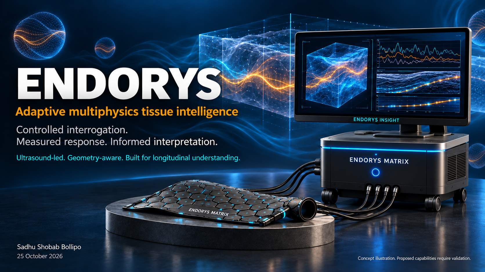

[](https://doi.org/10.5281/zenodo.24555613)
# Endorys

An independent research and technology venture with selectively open documentation and reproducibility tools.

**Selective openness:** public research, reproducible examples and independent review; future commercial engineering is reviewed separately before release. Existing licence grants remain in force. See [openness and commercial boundaries](OPENNESS.md).

## Run the Acoustic Reference Test (E001) research package

[Start here: runnable research package](research/e001_README.md) · [Protocol](research/e001_PROTOCOL.md) · [Record schema](research/e001_record.schema.json) · [Automated software checks](https://github.com/Endorys/platform/actions/workflows/e001-research-checks.yml)

The package includes raw-file integrity checks, waveform quality checks, an illustrative peak estimator, partial uncertainty reporting, plots, synthetic examples and physical-experiment planning templates. Python 3.11+; no third-party runtime dependencies.

```sh
cd research
python e001_demo.py --out e001_demo_output
python -m unittest e001_tests -v
```

**Synthetic demonstration only.** Passing software tests does not establish hardware, phantom or clinical performance. The immediate physical goal remains a reproducible acoustic phantom bench test. Equipment and acceptance criteria require review before collection. See [package licenses](research/e001_LICENSE.md).


**Ultrasound-led multiphysics tissue research.**

Exploring how controlled acoustic interrogation, conformal sensing and calibrated analysis could characterize tissue response across clinical and materials research.

[Documentation](docs/README.md) · [Get started](GETTING_STARTED.md) · [Research status](docs/STATUS.md) · [Branches](docs/BRANCHES.md) · [Contribute](CONTRIBUTING.md)



**Concept illustration—not a prototype or measured output.**

## What is here today?

| Available | Status |
|---|---|
| Platform architecture and branch programmes | Research specifications |
| Literature review and 28-item proof register | External precedents and unresolved Endorys questions |
| Eight experiment outlines | Planned; no execution claimed |
| Python acoustic example | Runnable synthetic illustration with self-checks |
| 19 concept images | Illustrative; not device output |
| Integrated physical or clinical results | Not established in this repository |

## Choose your path

| I want to… | Start here |
|---|---|
| Understand the platform | [Architecture](research/ARCHITECTURE.md) |
| Assess scientific credibility | [Evidence and validation guide](docs/EVIDENCE.md) |
| Build or reproduce an experiment | [Engineering guide](docs/ENGINEERING.md) |
| Explore applications | [Branches and applications](docs/BRANCHES.md) |
| Run something now | [Synthetic example quick start](GETTING_STARTED.md#run-the-synthetic-example) |
| Help develop Endorys | [Contribution guide](CONTRIBUTING.md) and [open issues](https://github.com/Endorys/platform/issues) |

## How the pieces fit

Matrix provides the proposed sensing surface; Interface defines contact and controlled loading; Insight processes registered measurements; Continuum preserves longitudinal context. Bench, Evidence and Challenge support reproducibility and critical evaluation. Explore, Vascular, Surgical and Therapy investigate specific applications.

[See all branches](docs/BRANCHES.md) · [View the visual gallery](images/README.md)

## Immediate goal and invitation

**Immediate goal: a reproducible acoustic phantom bench test.** Establish a repeatable fixed-geometry acoustic phantom baseline, then determine whether coupling, geometry and routing errors permit the intended measurement. See the [Acoustic Reference Test](research/EXPERIMENT_001.md) and the [evidence-gated roadmap](research/ROADMAP.md).

**Invitation: independent protocol review.** We invite an ultrasound/acoustic measurement researcher to review the [Acoustic Reference Test](research/EXPERIMENT_001.md), especially coupling controls, geometry uncertainty and acceptance criteria, before physical data collection. Please open an [Experiment proposal issue](https://github.com/Endorys/platform/issues/new/choose) titled “Acoustic Reference Test — independent protocol review.”

## Repository map

| Location | Contents |
|---|---|
| [docs/](docs/README.md) | Guided documentation, status, engineering and evidence navigation |
| [research/](research/README.md) | Detailed specifications, protocols, reviews, templates and synthetic example |
| [images/](images/README.md) | Concept gallery and image provenance |
| [.github/](.github/) | Issue and pull-request templates |
| [BRANCH_REGISTER.md](BRANCH_REGISTER.md), [NAMING.md](NAMING.md) | Canonical branch identities and historical aliases |

## Commercial direction

Endorys intends to pursue paid R&D and potential licensing of separately developed, rights-cleared technology. This is a future development model, not an available proprietary product or validated medical offering. Existing public Apache-2.0 and CC BY 4.0 reuse does not require a paid agreement. See [component release boundaries and dataset review](OPENNESS.md#release-boundaries-by-asset).

## Project and reuse

Founded by **Sadhu Shobab Bollipo**, Bengaluru, India. Endorys continues the programme previously called JUPITER, preserving its breast-first motivation and later clinical and materials/NDT exploration.


#### International Standards & Regulatory Alignment

The **ENDORYS™ (E001)** coupling-integrity and quantitative ultrasound repeatability framework is structured around established international clinical, medical safety, and industrial non-destructive testing (NDT) standards: 

#### 1. Clinical Quantitative Ultrasound (AIUM–RSNA QIBA PEQUS)

* **Biomarker Repeatability:** Evaluates inter-placement **Coefficient of Variation (CV%)**, **Time-of-Flight (ToF)** stability, and amplitude attenuation consistency across non-planar tissue-mimicking phantoms (1540 m/s soft-tissue background, 1585 m/s stiff inclusion).
* **Operator Independence:** Isolates and removes contact-pressure and interfacial air-gap variability required by the **RSNA Quantitative Imaging Biomarkers Alliance (QIBA) Pulse-Echo Quantitative Ultrasound (PEQUS)** profiles.

#### 2. Medical Electrical & Software Safety (IEC 60601-2-37:2024 & IEC 62304)

* **Acoustic Output & Thermal Safety (IEC 60601-2-37:2024, Ed. 3.0):** Designed for low-intensity sequential pitch-catch interrogation (~100 kPa peak acoustic pressure at 1.7–2.4 MHz), operating well below diagnostic Mechanical Index (MI ≤ 1.9) and Thermal Index (TIS/TIB ≤ 1.0) limits.
* **Deterministic Safety Gating (IEC 62304 & ISO 14971):** Implements auditable, rule-based **Coupling Quality Index (CQI)** frame rejection—preventing decoupled or air-gap corrupted waveforms from propagating into downstream diagnostic metrics without black-box neural-network drift.

#### 3. Industrial Curved-Surface NDT (ASTM E1316 / ISO 16810)

* **Continuous Couplant Verification:** Directly addresses **ASTM E1316** and **ISO 16810** ultrasonic testing requirements for verifying continuous acoustic boundary coupling across non-planar composite laminates (CFRP/GFRP) and cylindrical pipelines without mechanical raster scanning.

#### 4. Open Data & Benchmark Interoperability

* **Supported Formats:** Ingests standard CSV waveform captures (Philips PM3232 oscilloscope / k-wave-python FDTD simulations) alongside HDF5 **Ultrasound File Format (.uff)** datasets (research/uff_loader.py).
* **Permanent Archival Citation:** Benchmark releases are permanently archived on Zenodo under **[DOI: 10.5281/zenodo.24555614](https://doi.org/10.5281/zenodo.24555614)**.
Current stage: research concept and synthetic example. No validated medical device, clinical performance or therapeutic efficacy is asserted. See [scope and limits](research/RESEARCH_SAFETY_AND_LIMITS.md).

Covered original software is licensed under Apache-2.0 and covered original documentation under CC BY 4.0; the file-specific scope and Acoustic Reference Test package policy determine coverage. Hardware designs, generated visuals and third-party material are excluded unless separately licensed. See [license scope](LICENSE.md) before reuse. Citation information is in [CITATION.cff](CITATION.cff). Contact: [sadhu.shobab@gmail.com](mailto:sadhu.shobab@gmail.com).
