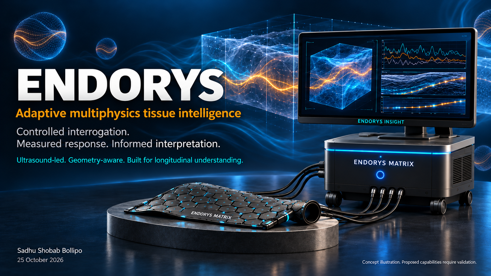

# Endorys

## Run the E001 research package

[Start here: executable experiment package](research/e001_README.md) · [Protocol](research/e001_PROTOCOL.md) · [Record schema](research/e001_record.schema.json) · [Automated software checks](https://github.com/Endorys/platform/actions/workflows/e001-research-checks.yml)

The package includes raw-file integrity checks, waveform quality checks, an illustrative peak estimator, partial uncertainty reporting, plots, synthetic examples and physical-experiment planning templates. Python 3.11+; no third-party runtime dependencies.

```sh
cd research
python e001_demo.py --out e001_demo_output
python -m unittest e001_tests e001_batch_tests -v
```

**Synthetic demonstration only.** Passing software tests does not establish hardware, phantom or clinical performance. The immediate physical goal remains a reproducible acoustic phantom experiment. Equipment and acceptance criteria require review before collection. See [package licenses](research/e001_LICENSE.md).

[Reproduce the software workflow](research/e001_REPLICATION.md) · [Review the acoustic protocol](research/e001_REVIEW_BRIEF.md)


**Ultrasound-led multiphysics tissue research.**

Exploring how controlled acoustic interrogation, conformal sensing and calibrated analysis could characterize tissue response across clinical and materials research.

[Documentation](docs/README.md) · [Get started](GETTING_STARTED.md) · [Research status](docs/STATUS.md) · [Branches](docs/BRANCHES.md) · [Contribute](CONTRIBUTING.md)



**Concept illustration—not a prototype or measured output.**

## What is here today?

| Available | Status |
|---|---|
| Platform architecture and branch programmes | Research specifications |
| Literature review and 28-item proof register | External precedents and unresolved Endorys questions |
| Eight experiment outlines | Planned; no execution claimed |
| Python acoustic example | Runnable synthetic illustration with self-checks |
| 19 concept images | Illustrative; not device output |
| Integrated physical or clinical results | Not established in this repository |

## Choose your path

| I want to… | Start here |
|---|---|
| Understand the platform | [Architecture](research/ARCHITECTURE.md) |
| Assess scientific credibility | [Evidence and validation guide](docs/EVIDENCE.md) |
| Build or reproduce an experiment | [Engineering guide](docs/ENGINEERING.md) |
| Explore applications | [Branches and applications](docs/BRANCHES.md) |
| Run something now | [Synthetic example quick start](GETTING_STARTED.md#run-the-synthetic-example) |
| Help develop Endorys | [Contribution guide](CONTRIBUTING.md) and [open issues](https://github.com/Endorys/platform/issues) |

## How the pieces fit

Matrix provides the proposed sensing surface; Interface defines contact and controlled loading; Insight processes registered measurements; Continuum preserves longitudinal context. Bench, Evidence and Challenge support reproducibility and critical evaluation. Explore, Vascular, Surgical and Therapy investigate specific applications.

[See all branches](docs/BRANCHES.md) · [View the visual gallery](images/README.md)

## Immediate goal and invitation

**Immediate goal: a reproducible acoustic phantom experiment.** Establish a repeatable fixed-geometry acoustic phantom baseline, then determine whether coupling, geometry and routing errors permit the intended measurement. See [Experiment 001](research/EXPERIMENT_001.md) and the [evidence-gated roadmap](research/ROADMAP.md).

**Invitation: independent protocol review.** We invite an ultrasound/acoustic measurement researcher to review [Experiment 001](research/EXPERIMENT_001.md), especially coupling controls, geometry uncertainty and acceptance criteria, before physical data collection. Please open an [Experiment proposal issue](https://github.com/Endorys/platform/issues/new/choose) titled “E001 independent protocol review.”

## Repository map

| Location | Contents |
|---|---|
| [docs/](docs/README.md) | Guided documentation, status, engineering and evidence navigation |
| [research/](research/README.md) | Detailed specifications, protocols, reviews, templates and synthetic example |
| [images/](images/README.md) | Concept gallery and image provenance |
| [.github/](.github/) | Issue and pull-request templates |
| [BRANCH_REGISTER.md](BRANCH_REGISTER.md), [NAMING.md](NAMING.md) | Canonical branch identities and historical aliases |

## Project and reuse

Founded by **Sadhu Shobab Bollipo**, Bengaluru, India. Endorys continues the programme previously called JUPITER, preserving its breast-first motivation and later clinical and materials/NDT exploration.

Current stage: research concept and synthetic example. No validated medical device, clinical performance or therapeutic efficacy is asserted. See [scope and limits](research/RESEARCH_SAFETY_AND_LIMITS.md).

Original software is licensed under Apache-2.0 and original documentation under CC BY 4.0. Hardware designs, generated visuals and third-party material are excluded unless separately licensed. See [license scope](LICENSE.md) before reuse. Citation information is in [CITATION.cff](CITATION.cff). Contact: [sadhu.shobab@gmail.com](mailto:sadhu.shobab@gmail.com).
