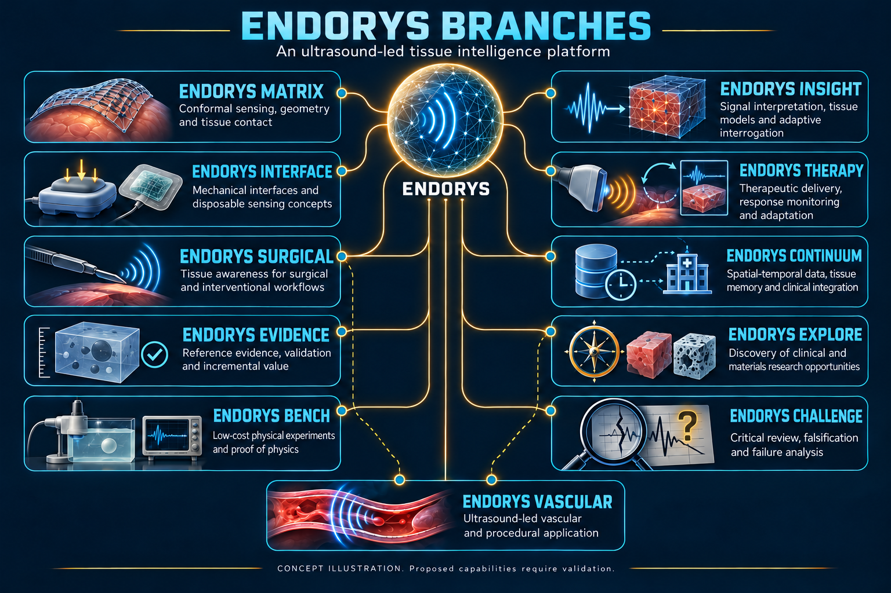

# Branches and applications

[Documentation home](README.md) · [Canonical register](../BRANCH_REGISTER.md) · [Historical aliases](../NAMING.md)

*Research programme map; categories are not validated indications.*

## Platform components

| Branch | Purpose | Detailed entry |
|---|---|---|
| Platform | Overall ultrasound-led multiphysics architecture | [Platform](../platform.md) |
| Matrix | Conformal sensing, geometry and contact | [Matrix](../matrix.md) |
| Interface | Controlled mechanical interrogation, coupling and disposable interface concepts | [Interface](../interface.md) |
| Insight | Acquisition-aware estimation, reconstruction and uncertainty | [Insight](../insight.md) |
| Continuum | Integration and longitudinal memory | [Continuum](../continuum.md) |

## Applications and discovery

| Branch | Purpose | Detailed entry |
|---|---|---|
| Explore | Clinical discovery AND materials/NDT research | [Complete categories](../explore.md) |
| Vascular | Vascular and procedural research | [Vascular](../vascular.md) |
| Surgical | Surgical assistance and procedural awareness | [Surgical](../surgical.md) |
| Therapy | Therapeutic acoustics and interventions | [Therapy categories](../therapy.md) |

Breast was an original motivation and remains in scope. Organ-specific concepts share components but need separate measurement and clinical evidence. Surgical assistance belongs to Surgical; it may use Matrix, Interface, Insight and Continuum. Treatment functions belong to Therapy and need their own safety and efficacy evaluation.

## Research assurance

| Branch | Purpose | Detailed entry |
|---|---|---|
| Bench | Apparatus and physical experiments | [Bench](../bench.md) |
| Evidence | Provenance, references and validation | [Evidence](../evidence.md) |
| Challenge | Falsification and failure analysis | [Challenge](../challenge.md) |

See the [application assessment](../research/APPLICATION_ASSESSMENT.md), [status](STATUS.md) and [gallery](../images/README.md). Historical category counts overlap; do not sum them into a claimed number of products.
