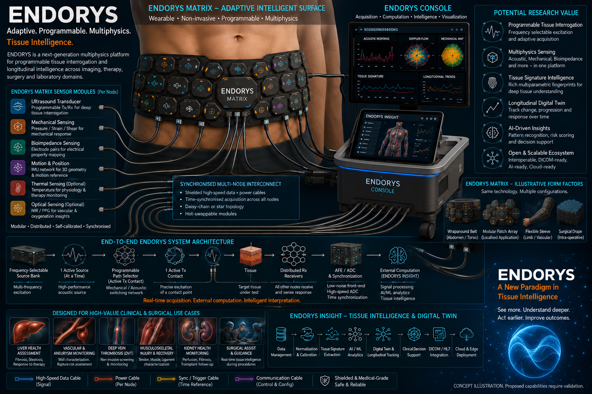

# Endorys image gallery

Rebranded concept illustrations, 26 October 2026. Founder and concept originator: Sadhu Shobab Bollipo.

These AI-generated illustrations depict proposed research architectures and applications. Screen outputs are illustrative, not experimental or patient data. Clinical benefits, measurement performance and prototype-status statements in older source concepts have not been independently verified. The organ-frequency chart preserves historical illustrative assumptions, not validated operating specifications. See the [current branch register](../BRANCH_REGISTER.md) for scope.

## Images

- [Endorys Matrix Anatomical Locations](Endorys_Matrix_Anatomical_Locations.png) — **Concept illustration—not a prototype or measured output.**
- [Endorys Matrix Forearm Sensor Functions](Endorys_Matrix_Forearm_Sensor_Functions.png) — **Concept illustration—not a prototype or measured output.**
- [Endorys Branch Research Concepts](Endorys_Branch_Research_Concepts.png) — **Concept illustration—not a prototype or measured output.**
- [Endorys Therapy Product Concept](Endorys_Therapy_Product_Concept.png) — **Concept illustration—not a prototype or measured output.**
- [Endorys Therapy Supervised Muscle Concept](Endorys_Therapy_Supervised_Muscle_Concept.png) — **Concept illustration—not a prototype or measured output.**
- [Endorys Explore Product Concept](Endorys_Explore_Product_Concept.png) — **Concept illustration—not a prototype or measured output.**
- [Endorys Branches and Purposes](Endorys_Branches_and_Purposes.png) — **Concept illustration—not a prototype or measured output.**
- [Endorys Breast Assessment Concept](Endorys_Breast_Assessment_Concept.png) — **Concept illustration—not a prototype or measured output.**
- [Endorys Breast Introduction Cover](Endorys_Breast_Introduction_Cover.png) — **Concept illustration—not a prototype or measured output.**
- [Endorys General Introduction Cover](Endorys_General_Introduction_Cover.png) — **Concept illustration—not a prototype or measured output.**
- [Endorys Platform Introduction](Endorys_Platform_Introduction.png) — **Concept illustration—not a prototype or measured output.**
- [Endorys Surgical Laparoscopic Abdomen](Endorys_Surgical_Laparoscopic_Abdomen.png) — **Concept illustration—not a prototype or measured output.**
- [Endorys Surgical Conventional Abdomen](Endorys_Surgical_Conventional_Abdomen.png) — **Concept illustration—not a prototype or measured output.**
- [Endorys Insight Breast Research Overview](Endorys_Insight_Breast_Research_Overview.png) — **Concept illustration—not a prototype or measured output.**
- [Endorys Therapy Domain Map](Endorys_Therapy_Domain_Map.png) — **Concept illustration—not a prototype or measured output.**
- [Endorys Explore Opportunity Map](Endorys_Explore_Opportunity_Map.png) — **Concept illustration—not a prototype or measured output.**
- [Endorys Organ Frequency Windows](Endorys_Organ_Frequency_Windows.png) — **Concept illustration—not a prototype or measured output.**
- [Endorys Product Concept](Endorys_Product_Concept.png) — **Concept illustration—not a prototype or measured output.**
- [Endorys Surgical Procedure Workflow](Endorys_Surgical_Procedure_Workflow.png) — **Concept illustration—not a prototype or measured output.**

## Platform introduction

**Concept illustration—not a prototype or measured output.**

## Branch map

**Concept illustration—not a prototype or measured output.**

## Product concept

**Concept illustration—not a prototype or measured output.**

## Provenance

18 illustrations were rebranded with the built-in image generation tool. One unlabelled research montage required no artwork change. Three identical source product-concept copies share one updated image. Original files remain preserved locally. These standalone assets do not update embedded images in older PDF or PowerPoint files. Generated visual assets remain outside the software/documentation license grants. See [license scope](../LICENSE.md).
