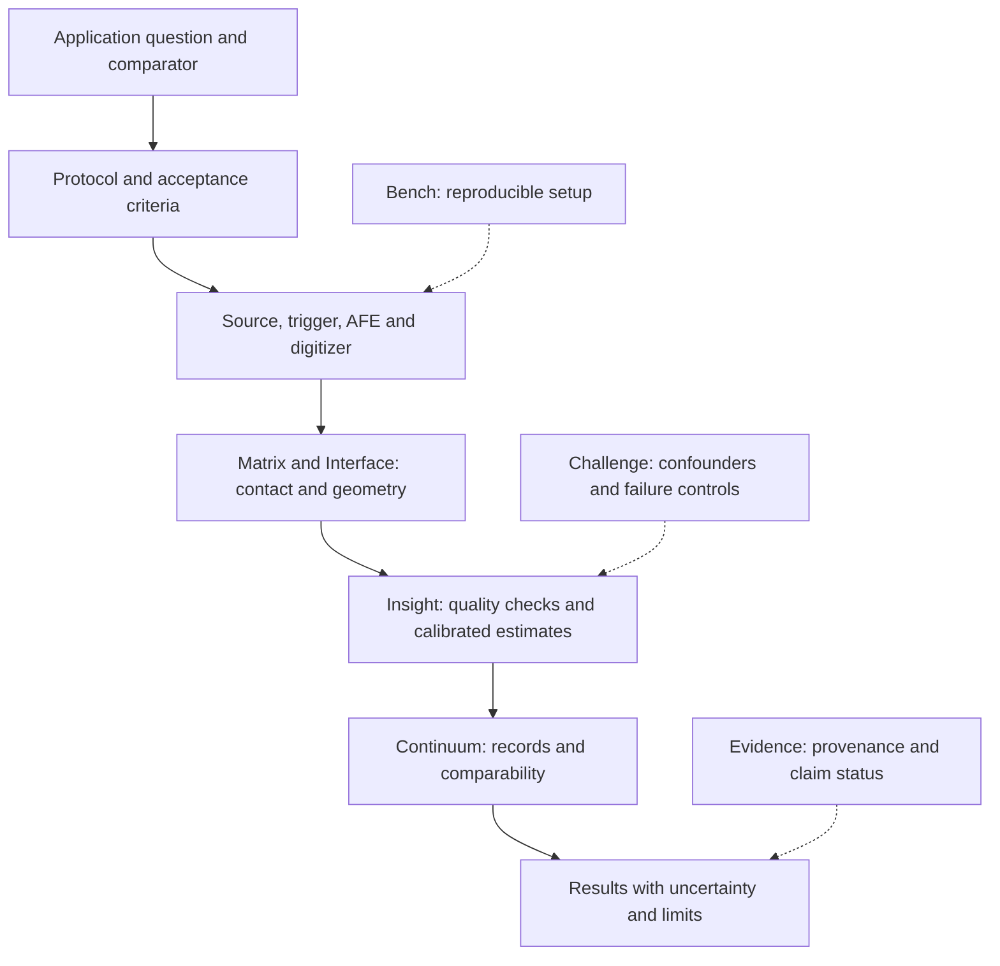

# Endorys architecture

Status: proposed research architecture, 26 October 2026. No integrated physical performance is established by these documents.

## Central idea
Endorys investigates whether ultrasound-led, controlled tissue interrogation can produce repeatable measurements of tissue response. Matrix is the conformal sensor interface; Insight is external acquisition analysis and interpretation. Additional modalities are hypotheses whose incremental value must be measured, not assumed.

## Acoustic chain
A selectable source bank drives one active source at a time. A programmable physical path connects that source to a selected passive transmit contact. Distributed receive elements measure the resulting acoustic response. A passive contact is not an independently powered transmitter. Every path introduces insertion loss, dispersion, reflections, settling time and possible leakage; these require measurement before scaling the array.

The acquisition sequence is: enter safe state, select source, select path, settle and verify, trigger excitation, acquire the receive window, preserve raw signals and metadata, deselect. Timing errors and coupling changes must be distinguished from tissue changes. A conventional direct transducer arrangement is a necessary baseline against which the routed concept is compared.

## Branch responsibilities
| Branch | Responsibility | Required interface |
|---|---|---|
| Matrix | Contact, receiving elements, geometry and local sensing | Raw samples, location, contact state, calibration IDs |
| Interface | Controlled mechanical interrogation and application-specific interfaces, including disposable concepts | Applied load, displacement, geometry, time and contact conditions |
| Insight | Signal processing, registration, estimation and uncertainty | Versioned inputs, assumptions, outputs and rejection reasons |
| Continuum | Integration and longitudinal memory | Comparable sessions, calibration lineage and change history |
| Evidence | Measurement and claim validation | Protocols, controls, references, data and negative findings |
| Bench | Reproducible laboratory development | Hardware revisions, fixtures and instrument records |
| Challenge | Stress testing and alternative explanations | Fault injection and confounder reports |
| Explore | Clinical opportunity discovery and materials/NDT research | Specific decision, specimen, comparator and evidence gap |
| Therapy | Proposed treatment-related investigations | Separate exposure, control, safety and efficacy validation |
| Surgical | Proposed intraoperative assistance | Sterile workflow, access, registration and clinical validation |
| Vascular | Vascular application programme | Anatomy-specific measurement and clinical endpoints |

See the [canonical branch register](../BRANCH_REGISTER.md). Research programmes overlap; they are not independent proven products.

## Other sensor streams
Force/strain can establish loading context. Bioimpedance can measure electrical response within electrode-dependent sensitivity volumes. Motion sensing can help track pose but does not automatically recover accurate transducer geometry. Optical, temperature and surface EMG channels are optional and sample different depths and spatial supports. A common timestamp does not make these channels spatially equivalent. Each needs calibration, registration and an explicit reason to exist.

## Frequency and timing
Acoustic carrier frequency, mechanical loading frequency, ADC sampling frequency, pulse repetition frequency and displayed frame rate are different quantities. Their specifications must be derived from the experiment. A controller such as an ESP32 may coordinate states; it is not evidence of sufficient analogue bandwidth or synchronized RF digitization.

## First implementation boundary
Begin with tethered, fixed-geometry, non-biological phantoms and external instruments. Establish an acoustic baseline before adding switching, conformal geometry, mechanics or sensor fusion. Wearability, self-calibration, diagnostic accuracy, digital-twin fidelity and real-time visualization remain separate validation questions.

## Architecture refinement — 29 October 2026

This refinement organizes the existing names; it does not introduce new products or establish physical performance. The [branch register](../BRANCH_REGISTER.md) remains the canonical naming source.

### Five architectural layers

| Layer | Existing branches | Boundary |
|---|---|---|
| Physical measurement | Matrix + Interface | Sensor/contact geometry, coupling, controlled loading and raw acquisition context |
| Analysis | Insight | Calibrated processing, quality rejection, estimation and uncertainty |
| Session and integration | Continuum | Versioned records, provenance, session comparability and future clinical interfaces |
| Application programmes | Explore + Vascular + Surgical + Therapy | Separate research questions, comparators, workflows and advancement decisions |
| Validation across all layers | Bench + Evidence + Challenge | Reproducibility, claim tracking and tests of alternative explanations |

The external acoustic source, receiver analogue front end, digitizer, trigger and acquisition controller must be explicit engineering subsystems. Matrix is not shorthand for a complete working acquisition instrument. Insight consumes acquisition records; it does not replace the physical instrumentation.

Architecture diagram only; not a prototype or measured output. Arrows describe dependencies and record flow, not a detailed electrical schematic.

### Programme boundaries and substreams

- **Explore — clinical discovery:** retain the breast-first motivation; define each candidate by a specific question and reference method. Breast assessment is a research candidate, not an established diagnostic capability. Other clinical categories remain opportunity records rather than independently validated indications.
- **Explore — materials/NDT:** retain a separate non-biological research stream with specimen-specific geometry, acoustic properties and comparators. Success here cannot establish clinical performance.
- **Vascular:** organize vascular measurement and procedural questions. It may share work with Explore and Surgical; overlapping entries must point to one experiment or claim record rather than be counted as independent evidence.
- **Surgical:** includes the proposed surgical assistant for conventional/open and laparoscopic procedures. Substreams are sensing around the field, registration to the procedure, visualization, and workflow/access assessment. Instrument tracking, tissue boundaries and actionable guidance each require separate validation. A visualization concept does not demonstrate navigation accuracy.
- **Therapy:** keep exposure delivery, monitoring and treatment-effect evaluation separate from diagnostic acquisition. No therapeutic output is part of the first implementation. Any later intervention requires its own equipment, exposure characterization and review.

Organ-specific programmes consume the same proposed measurement core only where their requirements are compatible. Different organs, access routes and procedures may require different fixtures, coupling and hardware. One conformal surface should not be assumed to serve every application.

### Minimum interface contracts

| Producer → consumer | Required record | Failure behaviour |
|---|---|---|
| Acquisition → Insight | Raw waveform reference and checksum, units, sample interval, channel ID, trigger convention, source settings, gain, geometry and calibration IDs | Mark missing, clipped, untriggered or uncalibrated records; retain raw data |
| Interface/Matrix → Insight | Contact state, pose/geometry reference, load when measured, temperature when measured, synchronization information | Record unavailable channels explicitly; do not invent sensor values |
| Insight → Continuum | Estimator/version, input IDs, quality status, units, uncertainty method, assumptions and rejection reasons | Do not present an invalid estimate as a valid result |
| Continuum → application | Session/specimen IDs, protocol and hardware versions, comparable-baseline decision and provenance | Flag incomparable sessions before interpreting change |
| Any layer → Evidence | Claim ID, supporting dataset/protocol, result, limitations and review status | Unmeasured or unsupported claims remain hypotheses |

These are required fields to formalize in the [data specification](DATA_SPECIFICATION.md), not a claim that a complete schema or implementation already exists.

### Separate the implementation paths

**Baseline path:** conventional direct acoustic source/transducer arrangement → fixed non-biological phantom → receiver/digitizer → raw records → simple estimator and quality checks. This is the dependency for [Experiment 001](EXPERIMENT_001.md).

**Routed research path:** source bank → experimentally characterized physical routing path → selected passive contact → phantom → distributed receivers. Compare this against the baseline, measuring loss, bandwidth, leakage, settling and repeatability before increasing node count. Routing feasibility remains unresolved.

**Later optional paths:** controlled mechanical loading, conformal/repositioned geometry and complementary sensors. Introduce one change at a time and measure its incremental contribution. AI, tomography and digital-twin outputs are separate research deliverables; they do not follow automatically from collecting multiple channels.

### Advancement gates

| Gate | Evidence required before proceeding | Current documentation status |
|---|---|---|
| G0 — specification freeze | One measurable target, fixture geometry, instrument inventory, units, numerical acceptance criteria and analysis plan | Protocol draft exists; numerical limits and equipment selection unresolved |
| G1 — direct baseline | Raw physical traces, calibration, uncertainty, coupling/reseating controls and independent sessions | No authenticated physical results established here |
| G2 — routed feasibility | Matched direct-versus-routed measurements; measured losses, dispersion, leakage and timing | Proposed, unverified |
| G3 — geometry and added sensors | Controlled geometry/reapplication tests; ultrasound-only baseline versus added-sensor results on held-out sessions | Proposed, unverified |
| G4 — application feasibility | Application-specific reference measurements, endpoints, access/workflow assessment and appropriate review | Proposed; no diagnostic or therapeutic claim established |

G2 is required for claims relying on routed excitation; it is not a prerequisite for every experiment using a conventional direct source. A programme may stop or redesign when its dependency fails. Acceptance limits must be selected before confirmatory data collection, not fitted afterward.

### Repository gaps to close next

1. **Freeze G0:** choose the first quantity, available instruments and a measured fixture geometry; then set numerical criteria with an acoustic measurement reviewer. Do not select parameters from concept images.
2. **Formalize data contracts:** publish a versioned schema and examples for valid, rejected and incomplete records; connect them to the existing data specification.
3. **Separate synthetic and physical evidence:** keep the runnable synthetic example clearly identified; create a physical dataset manifest only when actual data exist. Never substitute synthetic traces for G1 evidence.
4. **Connect claims to programmes:** reference the existing [evidence register](EVIDENCE_REGISTER.md) and experiment IDs from branch pages; retain both positive and negative findings.
5. **Add reproducibility checks:** verify the existing synthetic example and repository links automatically. Such checks establish software/document consistency, not instrument or clinical validity.
6. **Track decisions:** document direct-source baseline, routed-source feasibility and optional sensor additions as explicit decisions with rationale, alternatives and reversal criteria.

Existing concept-image labels, scoped licenses and the independent protocol-review invitation remain in force. These gaps are implementation and evidence work; additional illustrations alone will not close them.
