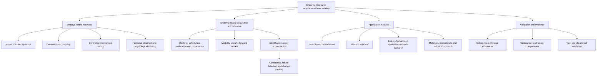

# Dated integrated technical evaluation

Original analysis: 16 October 2026; renamed 26 October 2026. This historical engineering assessment predates the complete branch recovery. The current [branch register](../BRANCH_REGISTER.md) and [Explore register](../explore.md) take precedence for naming and scope. Qualitative judgments are not measured readiness, costs or performance.

# Endorys: integrated branch and subbranch evaluation

Version: evidence-informed concept baseline, 16 October 2026.

This analysis propagates the retrieved Endorys ideas and the 39-reference evidence map through hardware, inference, applications, comparisons and validation. It covers the branches available in this conversation and the retrieved phone chat; it does not claim to recover every historical design. No prototype measurements, frozen specifications, bill of materials or experimental datasets were provided. Recommendations and priorities are engineering judgments, not measured readiness or commercial forecasts. This document does not modify other chats.

Companion: [28-item prior-art evidence map](LITERATURE_REVIEW.md). References [P1]–[P39] below refer to its source register. Additional sources [A1]–[A6] appear at the end.

## 1. Revised system definition

**Endorys is a proposed modular platform for controlled acoustic and mechanical interrogation, optional electrical/physiological sensing, and uncertainty-aware estimation of regional material or tissue response.**

Endorys Matrix is the sensing/interface hardware. Endorys Insight is the acquisition-aware reconstruction and inference layer. VIA is treated as the previously discussed vascular/procedural specialization. Endorys Explore is treated provisionally as the broader reusable material-interrogation abstraction mentioned in the phone chat; its independent scope is not otherwise specified. RAMBO and DieHard refer here to CT and MRI comparators, not fully specified proprietary devices.

The architecture should share calibrated hardware and inference components while keeping anatomy-specific sensors and claims separate. A common software schema is useful; forcing all sensors into one sheet is not a technical requirement.

## 2. Corrections that must reach every branch

| Earlier idea | Revised interpretation | Consequence across the system |
|---|---|---|
| Every sensor describes the same voxel | Each observation has its own spatial sensitivity and temporal window; registration does not equal equal resolution | Keep native support/resolution; fuse using forward models, not a shared display grid alone |
| More channels/features mean more information | Correlated or noisy channels may add little independent information | Select sensors and excitations using measured information gain and total burden |
| Sparse TX/dense RX is inherently novel | Synthetic-aperture and unequal-aperture precedents exist [P4,P5] | Benchmark the specific layout, sensitivity and cost/performance improvement |
| Strain plus sparse IMUs gives exact geometry | These signals constrain geometry but do not guarantee unique 3-D shape | Validate observability, anchors and residual geometric uncertainty |
| Surface pressure gives internal stress | Boundary pressure is only one constraint on internal stress | Include contact area, friction, boundary conditions, loading direction and mechanics |
| E = stress/strain gives local tissue stiffness | This is a restricted approximation, not a general heterogeneous-tissue inversion | Report apparent or relative stiffness unless absolute calibration/model assumptions support more |
| One timebase makes all signals simultaneous | Pulsing, blanking, averaging and sequential scanning create different effective windows | Store acquisition intervals and missing data; qualify simultaneity |
| Ratios such as change in stiffness/change in EMG are biomarkers | They are candidate descriptors affected by normalization, load and recruitment | Avoid unstable ratios; test reproducibility, confounders and clinical association |
| A response tensor is a causal tissue signature | It is initially a protocol-dependent fitted response matrix | Intervention and confounder experiments are needed for causal interpretation |
| Tissue mechanics differentiates Endorys from MRI | MRI elastography physically maps mechanical response [A1] | Compare task, access, workflow and accuracy rather than claiming exclusive physics |
| Many parameters compensate for lower resolution | Only if the extra parameters are accurate, independent and clinically useful | Define a clinical endpoint; do not trade pixel count against an unvalidated feature count |
| Earlier Siemens rejection reveals technical weakness or risk ownership | Rejection itself does not establish the reason | Keep business feedback separate from scientific evidence unless the actual feedback specifies causes |

## 3. Endorys Matrix: acoustic hardware branch

| Subbranch | Evaluation after prior-art review | Required design decision and physical gate |
|---|---|---|
| Transmitter material and architecture | Transmit pressure, bandwidth and efficiency must be established for the actual element; flexible-array precedent does not select a technology | Measure impulse response and acoustic field before selecting the final layout |
| Sparse TX placement | Plausible way to reduce transmit complexity; fewer views can worsen coverage and inverse conditioning | Compare layouts at equal exposure/acquisition time against a dense reference |
| Dense small RX | Potentially provides angular coverage, but small area changes sensitivity and electrical loading | Measure noise-equivalent detection and depth-dependent SNR rather than counting elements |
| TX/RX separation | Can enable different material/electronics optimization; introduces alignment and calibration burden | Calibrate transmit and receive transfer functions separately and their combined response |
| Pitch and aperture | Governs angular sampling, field of view and artifacts; bending changes the effective arrangement | Evaluate the worst operating curvature, not just the flat array |
| Multi-angle acquisition | Valuable for compounding and directional response; views may become redundant or inconsistent during motion | Record angle/pose uncertainty and compare reconstructions under controlled motion |
| Multi-frequency acquisition | Useful only over the system's usable transmit/receive bandwidth | Calibrate system response before attributing spectral differences to tissue |
| Raw RF and coherent capture | Important foundation for phase, motion and quantitative inversion; already established technically | Preserve raw samples, trigger state, calibration and processing versions |
| Multiplexing | Reduces hardware channels but makes the aperture sequential | Quantify synthetic-frame time and motion artifacts; do not call it simultaneous dense RX |
| Flexible versus stretchable construction | Bending and stretching create different geometric and reliability challenges | Begin with a mechanically constrained geometry, then add deformation modes one at a time |
| Backing, matching, shielding and interconnects | Affect bandwidth, ringing, crosstalk and fatigue across every application | Characterize the complete encapsulated stack, including electrodes and adhesives |
| Power and communications | Raw data and processing demands may dominate a wearable system | Measure with B approximately equal to N_RX × sample rate × bits/sample × receive duty factor, then add protocol overhead; select tethered/wireless architecture from that budget |

**Decision:** retain sparse TX/dense RX as an experimental architecture hypothesis. Do not make it the principal novelty claim without a defined comparison. A tethered bench instrument is an acceptable first implementation; standalone wearable electronics are a later gate.

## 4. Endorys Matrix: geometry, contact and environmental branch

| Subbranch | Evaluation | Propagated requirement |
|---|---|---|
| Distributed strain network | Measures deformation of its own substrate; does not directly measure all element coordinates | Establish sensor-to-element mechanics and detect delamination/slip |
| Sparse IMU anchors | Useful for gross motion/orientation; cannot alone recover arbitrary local sheet shape | Combine with independent geometric references; characterize drift and unobserved deformation |
| Acoustic self-localization | Physical precedents exist [P7]; travel time depends on geometry and propagation speed | Test geometry and sound-speed changes independently |
| Hybrid shape estimator | Potentially more robust than any one sensor, but correlated errors remain | Compare against external ground truth under bending, twisting and stretch |
| Contact pressure | Useful for boundary load and contact monitoring | Calibrate contact area, force distribution and hysteresis |
| Coupling map | Pressure does not prove acoustic coupling; gel/air/interface properties matter | Add echo-based quality evidence and deliberately introduce partial-contact faults |
| Adhesive and gel | Long wear has precedent [P8,P13]; reapplication and cleaning are separate problems | Track hydration, slip, skin/interface effects and calibration after replacement |
| Temperature | Supporting calibration/context sensor; skin temperature is not deep tissue temperature | Record measurement location and avoid inferring internal temperature without a model |
| Cross-session registration | Essential for longitudinal response; attachment consistency is not enough | Identify stable anatomical/material references and registration uncertainty |

**Dependency:** geometry and coupling errors propagate into beamforming, strain, attenuation, electrical reconstruction and apparent longitudinal change. This is a high-priority enabling branch, not a peripheral convenience.

## 5. Controlled mechanical interrogation branch

| Subbranch | Evaluation | What must be distinguished |
|---|---|---|
| Compression and indentation | Strong physical precedent; good bench starting point | Applied boundary force versus inferred internal stress |
| Oscillatory loading | Can probe a specified viscoelastic frequency band [P10] | Actuator transfer function, resonances and specimen response |
| Acoustic radiation force | Offers localized excitation, but requires suitable acoustic hardware and exposure characterization | Imaging pulse capability versus push-beam capability |
| Load/hold/release | Supports creep or stress relaxation depending on controlled variable | Constant force creep versus constant displacement stress relaxation; record both force and displacement |
| Cyclic loading | Supports hysteresis descriptors | Tissue loss versus adhesive/fixture friction, actuator lag and slip |
| Preload and boundary conditions | Can change every measured response | Record baseline preload, contact dimensions, restraints, orientation and loading history |
| Mechanical/acoustic/electrical interaction | Loading changes geometry and electrode contact as well as material state | Use factorial controls and matched unloaded references |
| Closed-loop excitation selection | Possible later benefit: choose the next safe measurement to reduce uncertainty | First validate open-loop protocols; do not adapt based on an unvalidated estimator |

**Decision:** use instrumented external loading first. Defer a wearable actuator and radiation-force subsystem until baseline material estimation works. There is no need to solve both actuator concepts at once.

## 6. Electrical, optical and physiological branches

| Module/subbranch | Retain and why | Limits and release gate |
|---|---|---|
| ECG | Optional cardiac timing reference | Surface ECG is not a voxel-local electrical measurement; test timing and pulse interference |
| Surface EMG | Preferred first electrical addition for a muscle demonstration | Electrode placement, recruitment, crosstalk and fatigue affect amplitude; prove overlap with observed muscle |
| Electromechanical delay | Credible candidate output with prior human evidence [P11,P29] | Different onset definitions and filter delays change the result; validate end-to-end latency |
| Bioimpedance spectroscopy | Measures complex response across electrical frequencies; adds material-sensitive information | Do not equate a spectrum directly with intracellular/extracellular fluid or diagnosis without a validated model |
| Electrical impedance myography | A regional muscle module with physical wearable precedent [P26] | Electrode/contact geometry, anisotropy and motion matter |
| EIT | An optional reconstruction module, not simply more electrodes | US/EIT already demonstrated [P27,P28]; determine sensitivity, resolution and prior-induced bias |
| EMG plus EIM | Technically precedented [P26]; useful combination candidate | Injected current can contaminate sensitive biopotentials; measure blanking/recovery and aliasing |
| PPG | Optional peripheral pulse-context channel | Optical pulse amplitude is not absolute regional perfusion; coupling and motion vary |
| NIRS | Optional oxygenation-related regional observation | Does not inherit ultrasound voxel resolution or establish blood flow by itself |
| SCG | Exploratory cardiovascular timing/context | A geometry IMU may lack the noise performance, bandwidth or mounting required; demonstrate rather than assume reuse |
| PCG | Optional heart-sound timing | Establish whether it adds information beyond ECG plus ultrasound; avoid feature accumulation |
| Temperature | Core contextual measurement where practical | Useful for drift/confounding, not a universal inflammation marker |
| Biochemical sensing | Defer by default | Add only for an intended use with proven incremental benefit; integrated acoustic/electrochemical precedent already exists [P14] |

**Revised core:** ultrasound + measured geometry/contact + calibrated timing and temperature context. Add controlled force when claiming mechanics. Add EMG for a muscle prototype. BioZ/EIT is a second controlled experiment rather than a mandatory component of every first build.

## 7. Endorys Insight: acquisition, calibration and data branch

### 7.1 Acquisition control

Use a hardware-referenced clock or measured synchronization architecture. Store trigger IDs and actual acquisition windows. Ultrasound RF timing, muscle electrical-mechanical timing, cardiac-cycle timing and slow relaxation have different error budgets; one sampling rate is inappropriate for all.

Schedule ultrasound pulses, receiver listening, impedance injection and biopotential acquisition. If blanking removes data, mark it missing. Do not interpolate across a transient and describe it as directly observed. Validate amplifier recovery after both normal and worst-case pulsing.

### 7.2 Data record

Each observation should include modality, native samples, timestamp/window, element/electrode IDs, pose estimate and covariance, excitation waveform/settings, applied load, temperature, coupling quality, gain/filter state, calibration ID, dropped-data mask and software/model version. Patient/specimen identity and consent context belong in protected metadata, not reconstructed images.

### 7.3 Calibration chain

Separate electronics calibration, transducer transfer functions, acoustic path, geometry, force and electrical contact calibration. Track uncertainty at each stage. A calibration that uses the same model and phantom to generate its claimed truth can conceal bias; include independent references and withheld specimen conditions.

### 7.4 Processing and architecture

Start with reproducible offline reconstruction and visible latency measurements. Then optimize only the demonstrated computational bottlenecks. Keep quantitative inversion, display interpolation and optional AI classification distinct. An attractive image is not evidence of quantitatively correct parameters.

## 8. Endorys Insight: inverse physics and identifiability branch

Use the conceptual measurement model:

`y_m = H_m(theta, geometry, boundary conditions, excitation, calibration) + noise_m`

Here m identifies a modality; theta is the selected tissue/material parameter subset. Different H_m have different sensitivity volumes. A shared coordinate system permits comparison; it does not make H_m identical.

| Inference subbranch | Evaluation | Required control |
|---|---|---|
| Beamforming and structural localization | Established foundation | Known targets, curvature and sound-speed mismatch |
| Full-wave acoustic inversion | Valuable but sensitive to aperture and model assumptions [P17] | Known material properties; independent geometry; initialization sensitivity |
| Joint acoustic-property inversion | Potentially useful; amplitude effects can be confounded | Independently change attenuation, coupling, scatterers and gain |
| Mechanics inversion | Established subsets, not universal inversion | Known loading/boundaries; compare relative and absolute parameter recovery |
| EIT with structural priors | Strong precedent | Compare no-prior, correct-prior and deliberately incorrect-prior reconstructions |
| Cross-modal fusion | Can add useful constraints | Compare separate estimators, simple fusion and joint physics at matched acquisition budget |
| Identifiability | Central unproven system property | Examine parameter sensitivities/correlations and show recovery of independent perturbations |
| Uncertainty | Required for every quantitative output | Coverage/calibration tests on withheld physical conditions, not only simulated noise |
| Failure detection | Some image/contact-confidence precedents [P31] | Out-of-range coupling, missing channels, motion and unfamiliar materials |
| AI assistance | May accelerate or regularize reconstruction | Prove no plausible-looking hallucination of structures/parameters under faults |
| Adaptive acquisition | Possible differentiation later | Show lower uncertainty or faster acquisition against a fixed protocol with equal exposure |

Do not invert the full tissue-state vector by default. Choose a minimal identifiable subset for each experiment, then enlarge it only when independent data support the added parameters. A regularizer can select one solution without proving it is the true one.

## 9. Tissue-state and response subbranches

| Proposed output | Current interpretation | Priority and evidence gate |
|---|---|---|
| Anatomy/structure | Reconstructed geometry/reflectivity under stated imaging conditions | Baseline; physical target/reference imaging |
| Sound speed | Effective acoustic parameter | After geometry is controlled; independent reference |
| Attenuation/scattering | Quantitative acoustic properties after system correction | Separate from contact and spectral response [P16] |
| Phase micro-motion | Displacement observation, not automatic disease specificity | Calibrated motion stage and drift floor |
| Strain | Derived spatial deformation | Address out-of-plane motion and noise amplification |
| Stiffness | Relative/apparent or absolute according to validated assumptions | Start with relative contrast; label honestly |
| G-prime/G-double-prime/viscosity | Model- and frequency-dependent viscoelastic estimates | Independent mechanical spectroscopy [P10,P19] |
| Relaxation/creep constants | Protocol-dependent fitted dynamics | Known force/displacement control and alternate-model tests |
| Hysteresis | Cycle-dependent energy loss or apparent loop area | Calibrated stress/strain before energy-density interpretation |
| Mechanical nonlinearity | Load-dependent constitutive response | Preload/strain tracking and independent mechanics [P15,P21] |
| Acoustic B/A | Nonlinear propagation parameter | Separate advanced branch; correct source/receiver distortion [P22] |
| Anisotropy/fibre direction | Direction-dependent response; full tensor only if supported | Known fibre phantoms and sufficient independent directions |
| Poroelasticity/permeability | Coupled solid-fluid model parameters | Separate from viscoelasticity using geometry/loading/flow controls [P23,P24] |
| Conductivity/permittivity | Electrical inverse estimates at declared support/resolution | Calibrated electrodes and reference materials [P27] |
| Flow | Velocity or volumetric flow only with a validated estimator | Reference pump/flowmeter and geometry |
| Oxygenation/perfusion | Modality-specific physiological observations/inferences | Do not combine these names into a single interchangeable variable |
| Longitudinal change | Difference after registration/calibration | Must exceed reapplication and drift variability |
| Tissue fingerprint | A task/protocol-dependent feature vector | Held-out validation; no disease-independent label implied |
| Digital tissue twin | Initially a longitudinal measurement record plus fitted response model | A predictive twin requires successful prospective response prediction |
| Cross-physics response tensor | Initially local fitted sensitivities, e.g. response to controlled inputs | Normalization, stable denominators, uncertainty, excitation diversity and intervention controls |

A useful response-model experiment is to predict held-out deformation or impedance under a new load, not merely reconstruct the observations used for fitting. This tests explanatory usefulness while leaving clinical causality as a separate question.

## 10. Application branches and subbranches

These priorities rank suitability for a first physical demonstration under the available evidence. They do not rank market size or prove clinical value. No clinical deployment is proposed before appropriate validation.

| Branch/subbranch | Potential question | Assessment and next evidence |
|---|---|---|
| Muscle activation and rehabilitation | Can structural motion, EMG and force be measured more repeatably together? | Preferred human-facing research direction after bench safety; strong prior art means focus on measurable repeatability or workflow improvement [P13] |
| Neuromuscular disease | Does combined sensing add to existing US/EMG/EIM assessment? | Candidate later study; labels/reference standards and representative cohorts required |
| Tendon/ligament injury | Can directional mechanical recovery be tracked? | Interesting but angle, load and reapplication are major confounders; fibre phantom before clinical claims |
| Scar maturation/healing | Does response change repeatably within a subject? | Longitudinal hypothesis; treatment/temperature/placement controls required |
| Superficial lesion characterization | Does a mechanical/electrical feature improve a defined classification task? | Existing competing methods and prior studies; pathology-linked prospective evidence needed |
| Tumour margins/biopsy targeting | Can abnormal response localize a better sampling region? | Higher burden: spatial accuracy and pathology registration; do not equate stiffness with malignant margin |
| Treatment response | Does a validated parameter change predict a meaningful outcome? | Promising research question; a parameter changing earlier than size must be demonstrated, not assumed |
| Liver/deep-organ fibrosis | Can accessible quantitative ultrasound improve repeatability or workflow? | Not automatically the easiest first target: depth, ribs, breathing and established elastography/MRE comparators |
| Edema/lymphedema | Can fluid-related changes be separated from tissue mechanics/contact? | Needs independent fluid and mechanical controls; BioZ alone does not resolve cause |
| Wound/diabetic foot/flap monitoring | Can selected acoustic/electrical/optical changes track a defined outcome? | Separate skin integrity, coupling and infection-control constraints; perfusion/oxygenation claims need dedicated references |
| Vascular wall mechanics | Can motion/load/flow timing be followed reproducibly? | Phantom vessel first; pressure inference requires its own calibration |
| DVT/compressibility | Can controlled compression and other signals improve monitoring? | Close integrated competitor/prior work ThrombUS+ [P33,P34]; avoid broad novelty claims |
| Cardiac specialization | Can ECG-referenced ultrasound add useful continuous measurements? | Wearable cardiac precedent [P3]; acoustic windows, respiration and placement remain difficult |
| VIA procedural monitoring | Can a defined procedural event be detected with reliable quality-aware sensing? | Freeze one event and anatomy; observational monitoring is separate from robotic control or autonomous intervention |
| Transcranial/neurovascular | Can useful signals be obtained through a specific skull window? | Conformal precedent [P1] does not remove skull/coverage constraints; defer as first platform proof |

**Candidate sequence:** calibrated soft-material phantom → muscle-like anisotropic phantom with electrical properties → constrained muscle/force research study after safety → one selected clinical endpoint. Keep oncology, deep organs, transcranial work and procedural autonomy as separate later programmes.

## 11. Non-clinical and Endorys Explore transfer branches

| Branch | What can transfer | What must be rebuilt or proven |
|---|---|---|
| Hydrogels and biomaterials | Loading rig, geometry tracking, acoustic/viscoelastic inversion, longitudinal database | Material-specific reference mechanics; MUVE is a direct benchmark [P19] |
| 3-D printed soft materials | In-situ time-series acquisition and change detection | Separate thickness, temperature, gelation and chemistry; physical ultrasound printing-monitoring precedent exists [A2] |
| Polymers/adhesives | Controlled cure/relaxation protocols and uncertainty framework | Appropriate coupling, frequency, temperature control and destructive/rheological references |
| Soft robotics | Geometry/strain tracking and response prediction | Separately validate sensing versus actuation; ultrasound-guided robot work is not proof of material-property inversion |
| Food materials | Acoustic/mechanical characterization workflow | Hygienic interface, product-specific temperature/composition models and process references; experimental precedents exist [A5] |
| Aerospace/composites | Array geometry, multi-angle acquisition and defect-localization software concepts | Acoustic anisotropy, high attenuation, guided modes, coupling and certified defect references; flexible transducer NDE precedents are longstanding [A3] |
| Pipes/curved metal structures | Conformal interface and phase-coherent acquisition architecture | Different material, frequency, matching layers and thermal environment; physical curved/high-temperature work exists [A4] |
| Permanent structural health monitoring | Calibration/provenance, baseline comparison and quality flags | Sensor aging, bond degradation, environment and operational loads must be separated from structural damage |
| Remaining-life prediction | Longitudinal record and forecasting framework | Controlled fatigue data with known failure outcomes; defect detection does not establish life prediction |

**Endorys Explore abstraction:** reuse the experiment controller, metadata schema, calibration/versioning, geometry framework and inverse-solver interfaces. Do not assume a medical patch, tissue constitutive law or clinical training set transfers to composites or metal. A shared software platform is plausible; one universal physical sensor/solver is not established.

## 12. RAMBO / CT and DieHard / MRI evaluation

The earlier CT-versus-MRI-versus-tissue-behaviour triangle is too simple. MRI elastography already maps mechanical response [A1]. Spectral CT has material-analysis capabilities [A6]. Established ultrasound also provides more than structural images. Endorys must be evaluated against the strongest relevant current method, not a simplified description.

| Comparison question | Fair test |
|---|---|
| Does Endorys detect a lesion? | Compare diagnostic performance against the appropriate clinical reference, not voxel size alone |
| Does it measure stiffness? | Compare with independent mechanics and relevant ultrasound/MR elastography |
| Does it provide useful electrical information? | Compare with EIM/EIT and existing US/EIT combinations |
| Does it monitor more accessibly? | Measure attachment, training, operator time, interruptions, usable-data fraction and full system cost |
| Does repeated monitoring help? | Demonstrate a clinically meaningful change above repeatability error and an action that benefits from it |
| Is it lower cost? | Include acquisition electronics, channel count, computation, calibration, consumables and maintenance |
| Is it complementary? | Identify information that changes a decision beyond the existing workflow |

There is no evidence here of Endorys's superiority, equivalence or replacement of CT/MRI. A defensible initial position is a candidate repeatable regional measurement tool for one task.

## 13. Cross-branch dependency and failure propagation

| Root error | Downstream appearance | Required discriminating experiment |
|---|---|---|
| Array shape error | False structural displacement, defocus, apparent property change | Change shape with unchanged phantom; compare external geometry |
| Poor coupling | Weak echoes mistaken for attenuation or abnormal tissue | Introduce controlled air gaps/contact variation |
| Changing preload | Apparent stiffness/nonlinearity and vascular change | Repeat at measured matched preload |
| Electrode slip/contact | Apparent conductivity/EMG change | Fixed electrical phantom and electrode-motion challenge |
| Temperature drift | Acoustic/electrical parameter shifts | Controlled temperature series with independent measurements |
| Channel timing drift | Motion/phase/localization errors | Shared reference signal across channels over time |
| Modality injection interference | False activation or altered spectra | Modality on/off combinations with unchanged specimen |
| Incorrect structural prior | EIT boundaries look plausible but wrong | Deliberately misregistered/wrong-prior tests |
| Deformation during sequential scanning | False 3-D anatomy or dynamics | Known moving phantom with controlled scan order |
| Model mismatch | Stable but biased recovered properties | Multiple materials/boundaries and alternate constitutive models |
| Reapplication error | False treatment progression/recovery | Remove/reapply without biological/material change |
| Training leakage | Inflated classifier accuracy | Split by specimen/person/session and hold out acquisition conditions |

## 14. Validation gates and decisions

Set numerical acceptance thresholds before testing from the intended measurement task. This analysis intentionally does not invent resolution, latency or diagnostic thresholds without hardware and intended-use specifications.

| Gate | Experiment | Advance only when |
|---|---|---|
| G0: freeze one claim | Specify target, depth, output, reference and intended comparison | One testable claim and documented assumptions exist |
| G1: instrument baseline | Electrical/acoustic/force calibration, fixed known targets | Reference errors and stability meet predefined budget |
| G2: geometry and contact | Controlled bends/stretch/contact faults | True changes can be separated from interface effects |
| G3: one mechanical parameter | Known phantom under calibrated loading | Independent reference agreement plus repeatability |
| G4: second modality | Add EMG simulator or electrical phantom without changing mechanics | No unacceptable interference; meaningful incremental information |
| G5: identifiability | Factorial phantoms varying mechanics, conductivity, geometry and temperature | Correct parameter responds while confounded parameters stay within uncertainty |
| G6: longitudinal robustness | Reattachment/operators/days and deliberate failures | Minimum detectable change and valid failure flags established |
| G7: biological feasibility | Approved, task-specific study after safety readiness | Measurable endpoint and appropriate reference; no diagnostic generalization |
| G8: clinical/product claim | Representative prospective comparison | Demonstrated benefit for the exact intended use and operating conditions |

Stop or simplify a branch if its claimed benefit disappears after correcting contact/geometry, requires unavailable independent excitations, is inferior to a simpler baseline, or cannot be recovered within the available noise/exposure/time budget. Negative results should change the design, not be hidden by additional modalities.

## 15. Overall evaluation and next concrete build

**Strongest foundations:** ultrasound acquisition, controlled deformation, established subset mechanics, physiological timing and calibrated longitudinal data.

**Most consequential unproven enablers:** geometry/contact observability, parameter identifiability, native-resolution fusion, repeatability after reapplication and reliable uncertainty.

**Potential differentiation hypotheses:** a specific deformable aperture with better calibrated performance; lower channel/power cost at matched measurement quality; contact-aware repeatability; or adaptive multimodal experiments that improve one decision-relevant measurement. None is demonstrated by the material available here.

**Defer:** universal disease fingerprints, full poroelastic/electrical/mechanical tensors, quantitative B/A, deep-organ generalization, remaining-life prediction and autonomous clinical intervention.

Recommended first instrument: a constrained ultrasound aperture, externally referenced geometry, instrumented compression stage, temperature/context logging, shared acquisition timing and raw RF storage. Use a simple phantom series with independently measured mechanics. Then add one electrical channel family. This isolates the core scientific question while preserving a route to a later conformal product.

## 16. All 28 original proof items carried forward

| Original proof items | Primary evaluation/gate |
|---|---|
| 1 signal quality; 2 sparse/dense aperture; 5 phase coherence | Acoustic hardware; G1 |
| 3 geometry; 4 coupling | Geometry/interface; G2 |
| 6 synchronization; 7 interference | Acquisition and optional sensor integration; G1/G4 |
| 8 3-D reconstruction; 9 angles; 10 frequencies; 11 acoustic properties | Acoustic/inverse-physics branches; G2/G5 |
| 12 strain; 13 stiffness; 14 viscoelasticity; 15 creep/hysteresis; 16 nonlinearity; 17 poroelasticity | Mechanical interrogation and tissue-state outputs; G3/G5 |
| 18 flow | Vascular/VIA module; task-specific G3/G7 |
| 19 impedance; 20 registration; 21 electrical-mechanical timing | Electrical modules and native-support fusion; G4/G5 |
| 22 longitudinal repeatability; 23 added fusion value; 24 identifiability; 25 confidence/failure | Core inference and cross-branch tests; G5/G6 |
| 26 durability; 27 safety | Hardware lifecycle and pre-biological testing; G1/G6/G7 |
| 28 clinical usefulness | Intended-use evaluation; G7/G8 |

## Additional primary sources

- [A1] Muthupillai et al. **Magnetic resonance elastography by direct visualization of propagating acoustic strain waves.** Science 269, 1854–1857 (1995). Gel modulus/reference mechanics and physical displacement measurements. https://pubmed.ncbi.nlm.nih.gov/7569924/ ; https://doi.org/10.1126/science.7569924
- [A2] **Real-time in-situ ultrasound monitoring of soft hydrogel 3D printing with subwavelength resolution.** Communications Engineering (2024). Physical printing/post-crosslinking monitoring; not a universal viscoelastic inversion. https://www.nature.com/articles/s44172-024-00318-w
- [A3] **Construction and evaluation of a new generation of flexible ultrasonic transducers.** Conference contribution, 1996, author institutional record. Curved-specimen and composite NDE experiments. https://strathprints.strath.ac.uk/48003/
- [A4] **The Use of Flexible Ultrasound Transducers for the Detection of Laser-Induced Guided Waves on Curved Surfaces at Elevated Temperatures.** Physical pipe/defect measurements. https://pmc.ncbi.nlm.nih.gov/articles/PMC5492689/
- [A5] **Non-contact ultrasonic quality measurements of food products.** Experimental oil and milk-product measurements; application-specific precedent. https://www.sciencedirect.com/science/article/pii/S0260877405004346
- [A6] Schilham et al. **Material analysis through X-ray attenuation decomposition in spectral computed tomography.** Scientific Reports 15, 27714 (2025). Includes illustrative clinical CT scans; not cited as a broad diagnostic-validation study. https://www.nature.com/articles/s41598-025-12640-0

## What remains unknown

Actual transducer technology, bandwidth/frequency, element geometry/count, target depth, loading design, electrode configuration, clocking, power budget, bill of materials, intended use and available test facilities remain unspecified. These prevent numerical feasibility, cost, product-readiness or patent-novelty conclusions. The analysis is comprehensive over the retrieved concept branches, not an assertion that all historical or possible Endorys ideas have been recovered.
